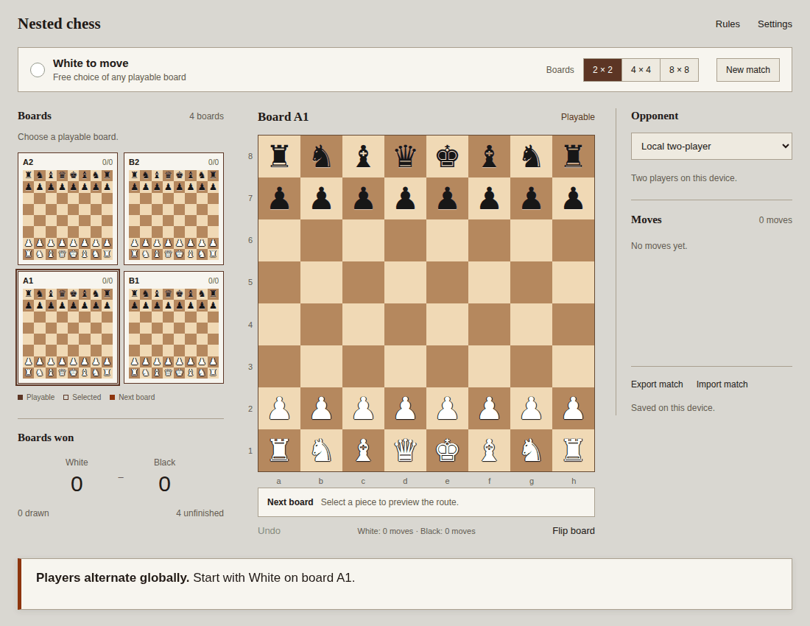

# Nested chess

A Rust king-capture chess engine on a routed 2×2, 4×4, or 8×8 grid of games,
with a playable browser UI, WebAssembly bindings, Python bindings, and a
global Rust negamax opponent using Fairy-Stockfish for local analysis.

[Play on GitHub Pages](https://balbok0.github.io/nested-chess/).

## Online play

The Rust server adds invitations, live multiplayer, persistent guest/account
sessions, match history, clocks, and whole-match Elo. Google, GitHub, and Microsoft
login require provider credentials. Guests can play unrated invitations immediately.
Local and browser-bot games continue to run on the device.

```sh
cp .env.server.example .env
# Set POSTGRES_PASSWORD in .env.
docker compose up --build -d --wait
```

Open <http://localhost:8080>, choose **Online**, create an invitation, and send its
link to the other player. Compose runs two interchangeable Rust replicas behind a load balancer,
with shared PostgreSQL storage and notifications. See [server setup and API](docs/server.md) for login
configuration, storage, clocks, deployment, and the protocol shared with mobile.
The GitHub Pages demo remains client-side; it does not host the multiplayer API.

## Android and iOS

The Capacitor apps share the UI and Rust/WASM rules engine. They support online
and offline two-player games; bots/evaluations remain available in the web app.
See [mobile setup](docs/mobile.md) for Android Studio/Xcode, server configuration,
native login, and build artifacts.

## Play locally

Requires Rust, Node.js 22+, npm, and GNU tar for source packaging.

```sh
rustup target add wasm32-unknown-unknown
cargo install wasm-bindgen-cli --version 0.2.105 --locked
npm ci
npm run dev
```

Open the printed local URL (normally <http://localhost:5173>). You play White
against Fairy-Stockfish, or choose two players on the same device. The app supports
all three grids, legal-move highlights, route previews, promotion choice, board
inspection, board flipping, undo, automatic local saves, and JSON import/export.

The default **System** theme uses Classic or Classic Dark according to the browser's
light/dark preference, including changes while the page is open. **Settings** also
lets you choose a fixed Classic, Classic Dark, Light, or Dark theme; an explicit
choice overrides the system preference and is preserved across reloads. The optional
**Show board evaluations** setting displays Fairy-Stockfish scores on each board
and the selected board. Positive scores favor White; negative scores favor Black,
in pawn units. The selected board has a vertical bar with White at the bottom and
Black at the top, independent of board orientation. The bar uses a nonlinear
visual scale, not a win probability; pending or unavailable scores are not shown
as an equal position. Forced king-capture predictions have separate labels. Evaluations
ignore routing and assume alternating local turns. They use full engine skill,
independently of the opponent difficulty, and run one position at a time. Identical
positions share a result, and stale searches are canceled when the position changes.
The setting is off by default and is saved on this device with the selected theme.
**Animate moves** controls engine piece movement and evaluation-bar transitions.
System reduced-motion preferences take priority. Engine turns have a short pause
so the move and its routing are easier to follow.

**Fischer Random (Chess960)** applies to new matches. Choose a shared random
Scharnagl start (0–959), or **Chess960ⁿ** for an independent draw per board (repeats
are possible). Each board has mirrored colors, opposite-color bishops, and the king
between its rooks. To castle, select the king and then its rook. The king finishes
on c/g and the rook on d/f; routing uses the king's landing square. King safety is
ignored under these king-capture rules, including during castling. These final
castling squares follow the [FIDE Chess960 rules](https://handbook.fide.com/chapter/e012023).

## Publish to GitHub Pages

After committing source changes on `main`, run `npm run deploy:pages`. This builds
the project at `/nested-chess/`, runs the JavaScript tests, and pushes the output to
the `gh-pages` branch. GitHub Pages publishes that branch. The site's service worker
provides the isolation needed by Fairy-Stockfish on static hosting; the first visit
may reload once. Local development still uses the normal server headers.

```sh
npm run build
npm run preview
```

The production output is `dist/`. The Fairy-Stockfish browser build uses shared
WebAssembly memory. Serve the app with these HTTP headers; Vite dev and preview
already set them:

```text
Cross-Origin-Opener-Policy: same-origin
Cross-Origin-Embedder-Policy: require-corp
```

Two-player play works without these headers; the opponent requires them. No
backend, accounts, or external inference service is needed.

## Rules

- White and Black alternate **globally**. Individual boards have no turn counter
  deciding who may move. Black can open an untouched board, and either color may
  move repeatedly on a local board across separate global turns.
- The first move can use any board. The landing square routes the opponent to a
  board in the macro grid: quadrants for 2×2, 2×2 square regions for 4×4, individual
  squares for 8×8.
- All routing coordinates use White's orientation, independent of UI flipping.
  Both local squares and macro boards run left to right, bottom to top. Board 0 is
  A1. For 2×2, `e4` routes to B1 (index 1), `d5` to A2 (index 2).
- **There is no check, king-safety restriction, or checkmate.** Capture the opposing
  king to win that board. Kings may be adjacent and may move into attacks.
- Standard piece movement, blocking, captures, pawn double steps, and all four
  promotions apply. Castling requires retained rights, the original king and
  rook, and an empty path; attacked squares do not prevent it. The king's landing
  square determines the route when castling.
- En passant is available on the next **local** move after a pawn's double step.
  Moves on other boards leave it available. The next move on that board, by either
  color, must use the capture or let it expire.
- If the destination is finished or has no moves for the incoming player, that
  player chooses any unfinished board where they can move. A board with no moves
  for one color stays open for the other color.
- A board automatically draws after 100 local moves without a pawn move or
  capture. Threefold repetition of the **entire nested position** draws all
  unfinished boards. A player having no move anywhere also draws unfinished
  boards. These are explicit v0 draw rules, not FIDE adjudication.
- Play ends when every board is settled. The player with more board wins wins
  the match; equal wins draw it. Wins award 1 point and draws award 0.5 points to
  each player. A match also ends immediately when one player's points exceed half
  the total boards. There is no clock.
- In local two-player mode, **Offer draw** asks the other player to accept or
  decline a draw on the viewed board. Acceptance closes it, awards 0.5 points each,
  and does not consume a turn. A closed required board releases board choice.



## Rust API

```rust
use nested_chess::{Color, Game};

let mut game = Game::new(2)?;
game.play(0, "e2e4")?;
assert_eq!(game.turn(), Color::Black);
assert_eq!(game.legal_boards(), vec![1]);
game.play(1, "e7e5")?; // Black opens an untouched board.
let restored = Game::load_json(&game.save_json()?)?;
# Ok::<(), nested_chess::Error>(())
```

`crates/engine` owns move generation, routing, scoring, draws, replay saves,
and feature planes. `Board` uses twelve bitboards and has **no local side to move**.
`Game` owns the single global color. `play` validates before mutation; a rejected
move leaves the state unchanged. Native `play`/`undo` return `Result<(), Error>`;
request `state()` separately when needed. Save files store initial positions plus verified
actions, including all repetition history. Undo replays that log.

`Game::from_fens` supports analysis positions. Provide one FEN per macro board;
each initial board must contain exactly one king of each color. FEN side fields
do not control local turns. Multiple boards can have pending en passant targets,
including targets for the color that is not currently moving. Finished boards are restored
by replay, not by importing kingless starting positions.

`Game::chess960(size, index)` creates a shared Chess960 start. The binding equivalents
are `NestedGame.chess960(size, index)` in JavaScript and `Game(size, chess960=index)`
in Python. Chess960 FENs use file-letter castling rights (Shredder-FEN), and castling
UCI moves target the rook's starting square. `move_details(board, uci)` reports the
actual landing square and optional rook movement for a legal move.

`Game::chess960_boards(size, &indices)` accepts one index per board in board-ID order
for Chess960ⁿ. Both bindings expose `chess960_boards(size, indices)` as a static method
(use a `Uint16Array` in JavaScript). Save files retain every board's starting FEN.

The `state()` view includes board results, legal board choices, move counts, and
the global turn. Local FEN views use that global turn and a synthetic fullmove
number of 1; they are position adapters, not standalone local game histories.

## Python

```sh
uv venv
uv run --with maturin maturin develop
uv run python
```

```python
import json
import nested_chess

game = nested_chess.Game(2)
game.play(0, "e2e4")
print(json.loads(game.state())["forced_board"])  # 1

# Uses the bundled npm WASM engine through a local Node UCI process.
opponent = nested_chess.Opponent(
    "node", ["scripts/fairy-uci.cjs"], "variants/nested.ini"
)
result = json.loads(opponent.search(game, max_depth=3, milliseconds=1000))
action = result["best_move"]
game.play(action["board"], action["uci"])
```

`state()`, `play()`, and `undo()` return JSON state strings in both bindings.
`legal_moves()` returns UCI strings (a Python list; a JSON array string in WASM).
`save()` returns a versioned replay string; `Game.load()` / `NestedGame.load()`
reconstruct a match. `piece_planes()` returns binary plane values.
`agree_draw(board)` records an agreement after both players have consented.
Version-2 saves record moves and draw agreements in one event history. Version-1
saves still load and retain their original finish-at-all-boards rule, including
games whose history continued past a majority; new matches use early completion.
Version-3 saves record the en passant expiry rule. Existing version-1/2 matches
retain global expiry for replay and undo; new matches use local expiry. Start a new
match to use the updated rule.

For a native Fairy-Stockfish binary, use
`Opponent("/path/to/fairy-stockfish", [], "/absolute/path/to/variants/nested.ini")`.
Rust exposes the same persistent, timeout-bounded process adapter as
`nested_chess::uci::UciEngine`. Ordinary Stockfish is incompatible with these rules.

`Opponent.search()` returns JSON with `best_move: {board, uci}`, `expected_score`,
`completed_depth`, and node/evaluation/cache/cutoff counts. Rust exposes the same
operation as `UciEngine::search(&game, SearchLimits { max_depth, max_nodes,
milliseconds })`, or runtime-independent async `search::best_move` with an
`Evaluator`. WASM `game.best_move(limits_json, evaluate)` returns a Promise of the
same JSON; the callback receives `(fen, chess960)` and resolves to JSON containing
`evaluation: {kind: "cp", value: white_relative_cp}` or `{kind: "capture", winner}`,
plus an optional UCI `best_move`. The existing native/Python `best_move(game,
board, skill, milliseconds)` remains available as the local-only baseline.

## Opponent strength

The custom [Fairy-Stockfish variant](variants/nested.ini) inherits extinction
chess, retaining only king extinction as the loss condition and normal
promotions. Kings are nonroyal, capturable pieces. Rust searches the full match
with negamax, alpha-beta, and iterative deepening. All legal board/move pairs stay
available; ordering favors the previous best move, cached Fairy-Stockfish moves,
captures, and promotions. Search uses complete cloned game states, preserving
routing, repeated local turns, draw counters, and repetition history.

The browser offers Beginner, Casual, Club, Strong, Expert, and Maximum presets
with depth caps 1–6, time budgets 300/600/1000/1600/2400/4000 ms, and local
Fairy-Stockfish node budgets 32/64/128/128/256/256. These are **uncalibrated
presets**, not 400/800/1200/1600/2000/2500 Elo bots.
Even the weakest preset may be difficult for a beginner.

Leaf evaluation targets `P(match win) + 0.5 * P(match draw)`. A half-point dynamic
program combines settled points with independent board-outcome estimates. Local
centipawn scores map to `p_white = (1 + tanh(cp / 400)) / 2`, clamped to
0.001–0.999; local capture predictions use those bounds too. Unfinished boards
initially have zero estimated draw probability, except boards frozen for both
colors, which are treated as eventual draws. Settled draws and draws found by
search remain exact. The DP also accepts supplied nonzero draw probabilities.

The forced board uses the incoming player's conditional local estimate. Other
boards average estimates with White and Black to move. Local results are cached
by FEN/color and castling convention within a search. These estimates are
uncalibrated and assume independent eventual board outcomes; Fairy-Stockfish's
local search still assumes alternating local turns. Global routing is exact within
the Rust search horizon. Actual terminal wins/losses outrank every heuristic.

The bot returns the last completed depth when a budget expires. If no iteration
finishes, it returns an ordered legal fallback with `completed_depth: 0` and
`expected_score: null`. Time is checked between oracle calls, so a call already
in progress can overrun the budget. Larger grids may complete shallower searches.

See [the design notes](docs/design.md) for representation costs, training
feasibility, engine research, and related games.

## Verification

```sh
cargo test --workspace
npm run build
npm test
uv run --with maturin maturin develop
uv run --with pytest pytest -q tests/test_python.py
cargo run --example selfplay
cargo run --example state_size
```

The Python suite runs real Fairy-Stockfish processes, including king captures and
Black opening an untouched board. It requires `npm ci` first. Browser QA covered
a real opponent reply, routing, grid sizes, saves, undo, and mobile layout.

The browser app and Fairy-Stockfish integration are **GPL-3.0-only**; see
[LICENSE](LICENSE). The independent Rust engine, WASM/Python bindings, and their
Rust code remain **MIT**; see [LICENSE-MIT](LICENSE-MIT). See the complete
[licensing map](LICENSING.md) and [third-party notices](THIRD_PARTY.md).

Every build packages downloadable application source, lockfiles, build scripts,
and the pinned Fairy-Stockfish source under `dist/source/`. The engine archive is
also retained in `third_party/fairy-stockfish/` with provenance, build instructions,
and a checksum. The live site's Rules dialog links these downloads and licenses.

[Buy me a coffee](https://www.buymeacoffee.com/balbok0).
